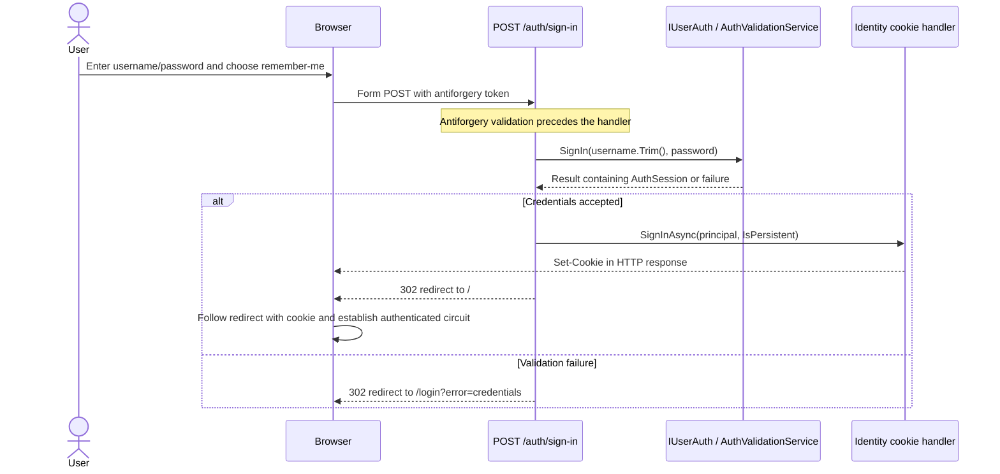

# Login workflow

Polisabroso authenticates with a **username and password**. The login page submits a browser form to an Auth-owned HTTP
endpoint. The endpoint validates credentials through `IUserAuth`, issues an ASP.NET Core Identity authentication cookie,
and redirects to `/`.

## Files and responsibilities

Paths below are relative to the repository root.

| File                                                                                              | Responsibility                                                                                          |
|---------------------------------------------------------------------------------------------------|---------------------------------------------------------------------------------------------------------|
| [Login.razor](../src/Polisabroso.App/Modules/Auth/UI/Login.razor)                                 | Form markup, username/password inputs, remember-me checkbox, antiforgery token, and error presentation. |
| [Login.razor.cs](../src/Polisabroso.App/Modules/Auth/UI/Login.razor.cs)                           | Password input state and mapping the `error` query parameter to Spanish feedback.                       |
| [AuthEndpoints.cs](../src/Polisabroso.App/Modules/Auth/Internal/AuthEndpoints.cs)                 | Form binding, credential-validation call, cookie issuance, and redirects.                               |
| [IUserAuth.cs](../src/Polisabroso.App/Modules/Auth/Api/IUserAuth.cs)                              | Module contract for credential validation and materialized session data.                                |
| [AuthValidationService.cs](../src/Polisabroso.App/Modules/Auth/Internal/AuthValidationService.cs) | Identity queries, password/account checks, and gathering roles and claims.                              |
| [AuthConstants.cs](../src/Polisabroso.App/Modules/Auth/Internal/AuthConstants.cs)                 | Shared application authentication scheme: `Identity.Application`.                                       |
| [Program.cs](../src/Polisabroso.App/Host/Program.cs)                                              | Identity/cookie registration, middleware, and endpoint registration.                                    |

## Request sequence



1. The browser loads `/login`. The page renders the form and an `AntiforgeryToken` component.
2. The user submits the form. Browser validation requires the username and password before a normal submission.
3. ASP.NET Core binds the submitted fields and validates antiforgery before executing the endpoint handler.
4. The endpoint trims the username and passes the password unchanged to `IUserAuth.SignIn`.
5. `AuthValidationService` looks up the username with `FindByNameAsync`. There is no email lookup fallback. An
   email-shaped value only works if it is itself the account's username.
6. The service checks the password with `lockoutOnFailure: true`. Identity applies account eligibility and lockout
   checks; the host requires confirmed accounts. The service also rejects accounts requiring two-factor authentication
   because this flow does not complete a second factor.
7. Success returns an `AuthSession` with the user ID, username, roles, and claims, including claims inherited from
   roles. This result alone does not issue a cookie.
8. The endpoint constructs a `ClaimsIdentity` using the configured name/role claim types and the application scheme,
   then calls `HttpContext.SignInAsync` with that scheme.
9. The cookie response and redirect let the browser load `/` with the new authentication cookie and establish an
   authenticated Blazor circuit.

Database access stays in the Auth module's internal service. The component handles input and presentation; it does not
query Identity stores.

## The form and its endpoint

The form is declared as:

```html
<form class="login-form" method="post" action="auth/sign-in" data-enhance="false">
```

Its action resolves relative to the application's base URL. The endpoint is registered with
`MapPost("/auth/sign-in", SignInAsync).AllowAnonymous()` so a user can submit credentials before authenticating.

| HTML field name              | Endpoint parameter                      | Meaning                                                                                                |
|------------------------------|-----------------------------------------|--------------------------------------------------------------------------------------------------------|
| `username`                   | `[FromForm] string username`            | Account username; input type is `text`, with `autocomplete="username"`.                                |
| `password`                   | `[FromForm] string password`            | Password rendered by `PasswordField`, with `autocomplete="current-password"`. Whitespace is preserved. |
| `remember`                   | `[FromForm] bool? remember`             | `true` when checked; absent when unchecked.                                                            |
| `__RequestVerificationToken` | Validated by antiforgery infrastructure | Hidden form token rendered by `AntiforgeryToken`; checked against the browser's antiforgery cookie.    |

The endpoint expects form data, not a JSON request body. A normal browser submission uses
`application/x-www-form-urlencoded`.

### Why a browser form and a POST endpoint?

The app renders its routes with `InteractiveServer`. Interactive component events run through the existing Blazor
circuit. Cookie issuance needs a fresh HTTP response where the server can write a `Set-Cookie` header; attempting to
write headers after a response has started fails. See
Microsoft's [Blazor HttpContext guidance](https://learn.microsoft.com/en-us/aspnet/core/blazor/components/httpcontext?view=aspnetcore-10.0).

The native form submission provides that HTTP request/response boundary. `data-enhance="false"` keeps submission as a
full browser navigation. There is no Blazor `@onsubmit` handler preventing the native submission. After the redirect,
the new document and circuit receive the authenticated principal.

POST places credentials in the request body rather than the URL and performs the session-changing operation. HTTPS
protects the request in transit; POST itself is not encryption. Antiforgery protects the form submission against
cross-site request forgery. `AllowAnonymous()` does not disable that protection.

## How `login-remember` persists the session

The checkbox is:

```html
<input id="login-remember" name="remember" type="checkbox" value="true" />
```

`login-remember` is the DOM ID used by its label. **The `name="remember"` attribute determines the posted field name.**
HTML forms omit unchecked checkboxes, so the endpoint accepts a nullable Boolean and uses:

```csharp
new AuthenticationProperties { IsPersistent = remember == true }
```

| Checkbox state | Posted value    | `IsPersistent` | Browser cookie behavior                                                                                                                                  |
|----------------|-----------------|----------------|----------------------------------------------------------------------------------------------------------------------------------------------------------|
| Checked        | `remember=true` | `true`         | Persistent cookie with an expiration date; it can survive browser restarts until it expires or is removed.                                               |
| Unchecked      | Field omitted   | `false`        | Session cookie without a persistent expiration date; the browser normally removes it when its session ends. Browser session restoration can affect this. |

In both cases the app authenticates immediately. Persistence controls browser storage across sessions, not whether the
login succeeds or which permissions the user receives.
Microsoft's [cookie authentication documentation](https://learn.microsoft.com/en-us/aspnet/core/security/authentication/cookie?view=aspnetcore-10.0)
explains `IsPersistent` and cookie issuance.

### What is stored, and where?

With the current configuration, the Identity cookie handler writes `.AspNetCore.Identity.Application` to the browser. It
contains a Data Protection-protected authentication ticket with the principal's claims and authentication properties.
The password is not part of that ticket. This implementation does not put the login in local storage or create a
database-backed session record.

On subsequent HTTP requests, the browser sends the cookie. Authentication middleware validates the ticket and populates
`HttpContext.User`. Blazor obtains the principal when establishing its circuit; `AddCascadingAuthenticationState` makes
authentication state available to components. The `AuthSession` returned by the service is an intermediate result, not a
persistent session store.

The endpoint does not set `ExpiresUtc`, and the host does not override cookie lifetime options. The framework defaults
are a **14-day ticket lifetime** and **sliding expiration**: qualifying HTTP requests after the midpoint of the lifetime
can renew the cookie. These defaults apply to ticket validity even for a browser session cookie; the checkbox does not
mean unlimited validity. See the
framework's [CookieAuthenticationOptions source](https://source.dot.net/Microsoft.AspNetCore.Authentication.Cookies/CookieAuthenticationOptions.cs.html).

An active circuit is separate from the cookie's lifetime. This project does not register a custom revalidating
authentication-state provider, and navigation inside a circuit should not be described as automatically rechecking the
database or renewing the cookie on every navigation.
Microsoft's [Blazor authentication documentation](https://learn.microsoft.com/en-us/aspnet/core/blazor/security/?view=aspnetcore-10.0)
describes circuit authentication and the template's optional revalidation provider.

## Failures and redirects

| Outcome                                                                     | Response                                                                                        |
|-----------------------------------------------------------------------------|-------------------------------------------------------------------------------------------------|
| Valid credentials                                                           | Cookie issuance followed by a local `302` redirect to `/`.                                      |
| Service rejects credentials/account state, including required second factor | Local `302` redirect to `/login?error=credentials`; the page displays generic Spanish feedback. |
| Exception during the handler                                                | Server-side error logging and local `302` redirect to `/login?error=unavailable`.               |
| Invalid/missing antiforgery token                                           | Rejected before the handler, with `400 Bad Request`.                                            |

The handler returns fixed local destinations and never includes credentials in redirect URLs. The page maps recognized
error codes to fixed text rendered with `role="alert"`. Password recovery remains a placeholder.

## Verification

[AuthHttpTests](../tests/Polisabroso.Auth.Tests/AuthHttpTests.cs) exercise an actual HTTP server and verify that missing
antiforgery is rejected, valid username form posts redirect, persistence changes the cookie's `Expires` attribute, and
the next request authenticates using that cookie. The test host uses the real cookie handler with mocked credential
validation.

[AuthEndpointsTests](../tests/Polisabroso.Auth.Tests/AuthEndpointsTests.cs) cover principal claims, checkbox values,
username trimming, password preservation, and failures without cookie
issuance. [AuthValidationServiceTests](../tests/Polisabroso.Auth.Tests/AuthValidationServiceTests.cs) cover Identity
validation, account restrictions, roles/claims, and rejection of email fallback.

Run the suite from the repository root:

```powershell
dotnet test Polisabroso.sln -c Release
```
